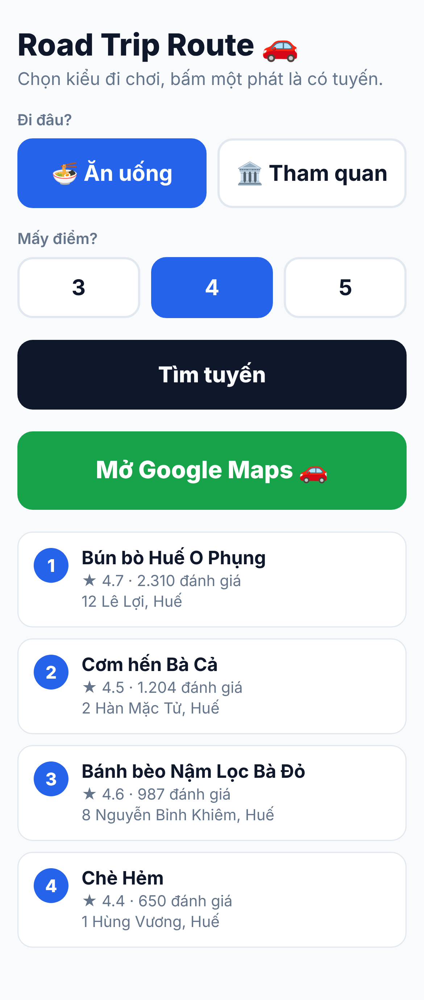

# Road Trip Route 🚗

Ngồi trong xe ở thành phố lạ, bấm một phát là có tuyến 3–5 điểm **ăn uống** hoặc **tham quan** quanh bạn, rồi mở thẳng Google Maps dẫn đường.



## Cách chọn điểm
- Google Places API (New) Text Search quanh vị trí hiện tại (bán kính ~5km)
- Chỉ lấy chỗ **đang mở cửa**, **rating ≥ 4.3** (Google chỉ lọc theo bước 0.5 nên app xin từ 4.0 rồi tự lọc lại)
- Ưu tiên chỗ **nhiều đánh giá nhất** (đoán quán local đông khách)
- Xếp thứ tự "gần trước, xa sau", mở Google Maps chế độ lái xe

API key chỉ nằm ở server (`/api/route`), không bao giờ xuống trình duyệt.

## Tạo Google Maps API key
1. Vào [Google Cloud Console](https://console.cloud.google.com/), tạo project (cần bật billing, có hạn mức miễn phí hằng tháng).
2. **APIs & Services → Library** → bật **Places API (New)**.
3. **APIs & Services → Credentials → Create credentials → API key**.
4. Bấm vào key → **API restrictions → Restrict key → chọn Places API (New)** → Save.
5. **Chặn hoá đơn bất ngờ** (link Vercel ai cũng gọi được): **APIs & Services → Places API (New) → Quotas** → đặt giới hạn số request/ngày (vd 100), và **Billing → Budgets & alerts** → tạo budget có cảnh báo email.

## Deploy lên Vercel
1. Vercel → **Add New → Project** → Import repo `road-trip-route`.
2. **Environment Variables**: `GOOGLE_MAPS_API_KEY` = key ở trên.
3. **Deploy**. Mở link HTTPS trên điện thoại, cho phép định vị là chạy.

> Nên cài app Google Maps trên điện thoại: link mở trong trình duyệt di động chỉ nhận tối đa 3 điểm dừng giữa, chọn 5 điểm có thể bị rớt bớt.

## Chạy local
```bash
cp .env.example .env.local   # điền key
npm install
npm run dev
```

```bash
npm test
```
